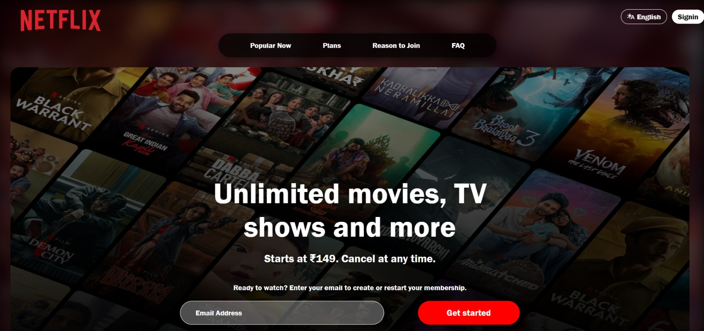
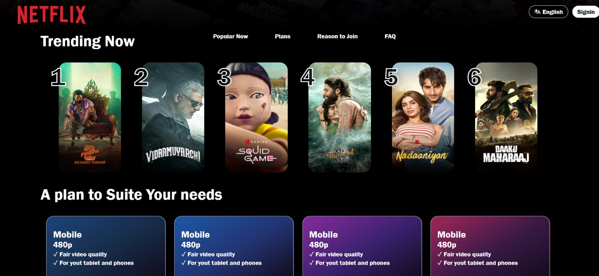

# 🎬 Old Netflix UI Clone — 2022

A snapshot of one of my early web development projects from **2022** — a Netflix-inspired UI clone created while I was exploring frontend web development.

This repository is preserved as a **technical memory and archive of my learning journey**, rather than as a representation of my current development stack.

## 📌 About the Project

This project recreates the visual experience of a Netflix-style streaming interface using fundamental frontend technologies.

The project focuses on:

- Responsive web interface design
- Netflix-inspired layout and styling
- Navigation and content sections
- Movie and show presentation
- Frontend structure and styling
- Early experimentation with web development

## 🛠️ Technologies Used

- HTML5
- CSS3
- JavaScript
- Frontend Web Development
## 🖥️ UI Preview

Here are screenshots of the Netflix-inspired interface created in this project.

### 🏠 Homepage



### 🔥 Trending Now



## 🚀 Run Locally

1. Clone this repository:

   ```bash
   git clone https://github.com/RatneshPathak/OldNetflixUI-Clone-2022.git
   ```

2. Open the project folder.

3. Open `index.html` in your browser to view the interface.

   Alternatively, use the Live Server extension in VS Code.

## 📁 Project Structure

```text
OldNetflixUI-Clone-2022/
├── index.html
├── netflix.css
├── README.md
├── screenshots/
│   ├── netflix-homepage.jpeg
│   └── netflix-trending-now.jpeg
└── netflix-clone-LU/
    └── Original project assets and files
```

## 🛠️ Technologies Used

- HTML5
- CSS3
- JavaScript
- Responsive UI development

## 📂 Project Structure

```text
OldNetflixUI-Clone-2022/
│
├── index.html
├── netflix.css
│
└── netflix-clone-LU/
    └── Project files
## 📌 About

An archived Netflix-inspired UI clone originally created in 2022 as part of my early frontend web development journey. This repository preserves the original project and documents its interface for reference.

**Developer:** [Ratnesh Pathak](https://github.com/RatneshPathak)

**Repository:** [OldNetflixUI-Clone-2022](https://github.com/RatneshPathak/OldNetflixUI-Clone-2022)


